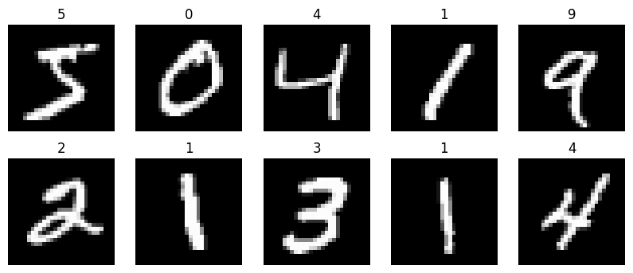
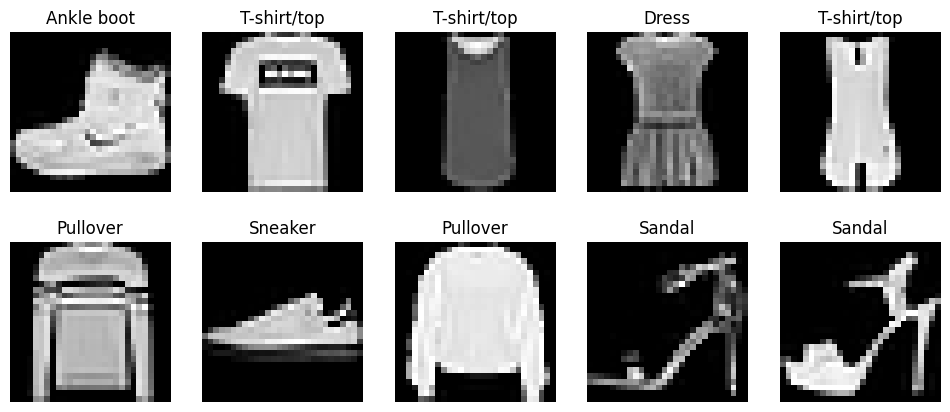
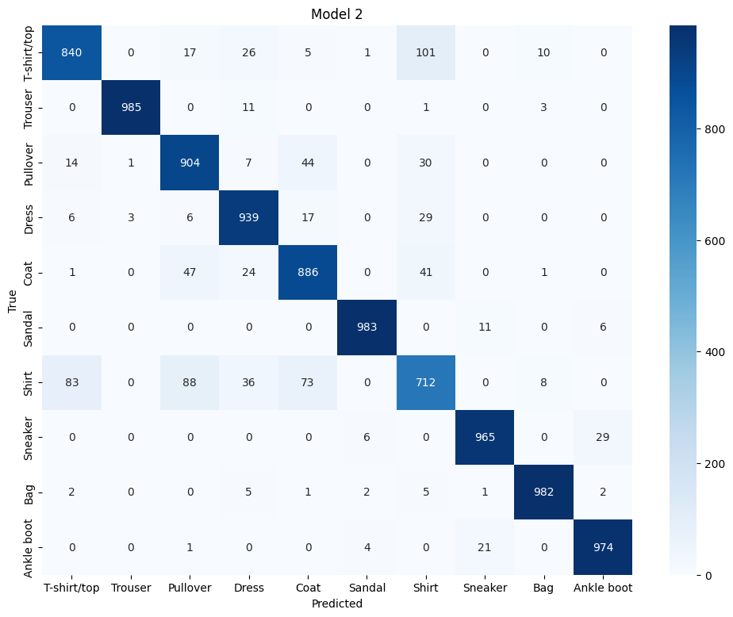
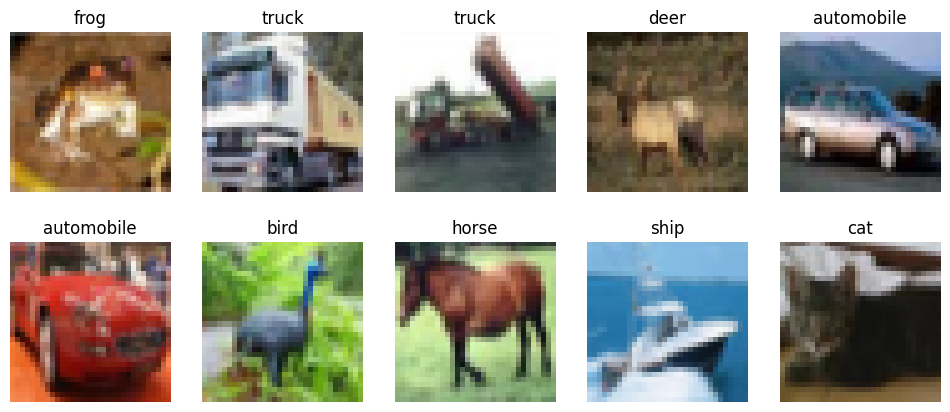
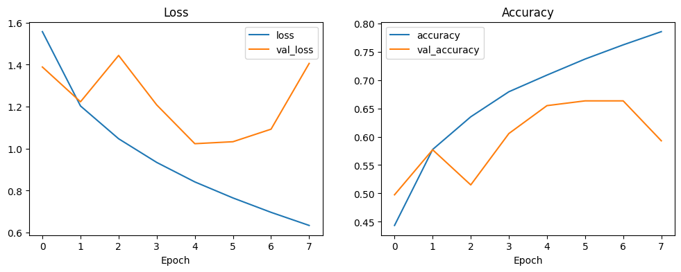
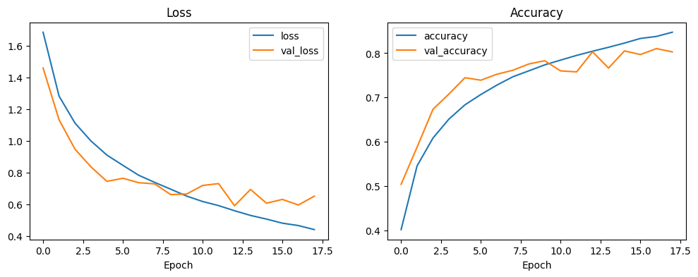
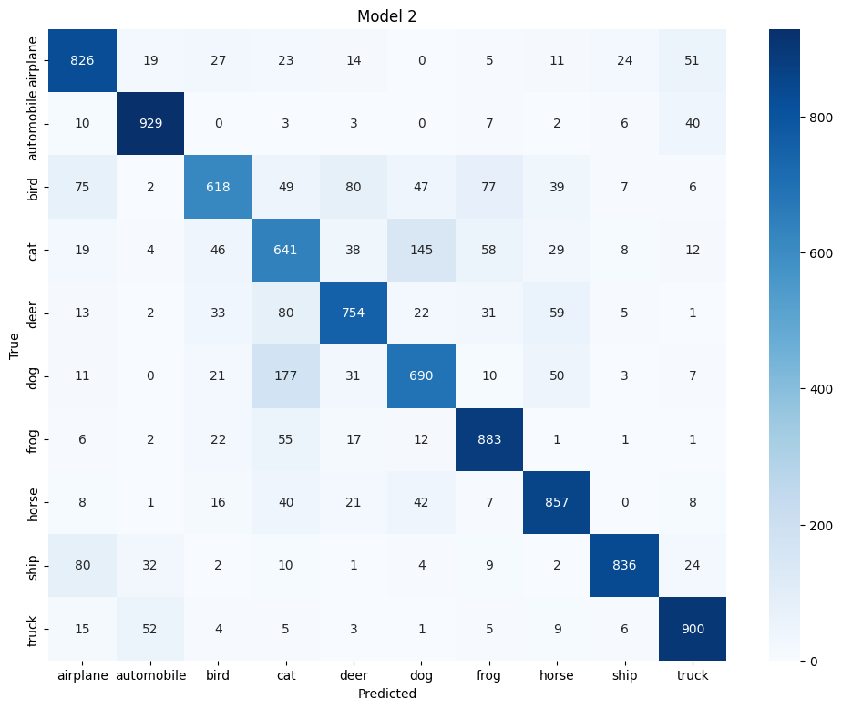

# CNN Image Classification

Three image classification projects with Convolutional Neural Networks in TensorFlow / Keras, from an easy dataset to a harder one.

| Project | Images | Classes | Best test accuracy | Notebook |
|---|---|---|---|---|
| MNIST | 28×28 grayscale | 10 handwritten digits | **98.6%** | [Open](MNIST/Keras_CNN_MNIST.ipynb) |
| Fashion MNIST | 28×28 grayscale | 10 kinds of clothes | **91.7%** | [Open](FASHION_MNIST/fashion_mnist.ipynb) |
| CIFAR-10 | 32×32 color | 10 objects and animals | **79.3%** | [Open](CIFAR/Keras_CNN_CIFAR_10.ipynb) |

All three datasets are downloaded automatically with `tensorflow.keras.datasets`, so no data files are needed.

## How every notebook works

1. Load the data and look at some images
2. Scale the pixels to 0–1 and one-hot encode the labels
3. Build a CNN with `Conv2D` + `MaxPool2D` layers and a `Dense` classifier
4. Train with 10% of the training set as validation and `EarlyStopping(restore_best_weights=True)`
5. Evaluate on the test set (used only at the end) with a classification report and confusion matrix
6. Predict single images

---

## 1. MNIST: handwritten digits



One conv layer (32 filters) → max pooling → `Dense(128)` → `Dense(10, softmax)`.

**Test accuracy: 98.6%.** Even a very small CNN is enough for this dataset.

---

## 2. Fashion MNIST: clothes



I compared two models:

| Model | Architecture | Epochs | Test accuracy |
|---|---|---|---|
| Model 1 | 2 conv layers (4×4) + `Dense(784)` + `Dense(392)` with dropout | 8 | 89.1% |
| Model 2 | 2 conv layers (3×3, `padding='same'`) + **BatchNormalization** + `Dense(128)` | 11 | **91.7%** |

Model 2 is better even with fewer parameters (422K vs 731K).



Most mistakes are between **Shirt**, T-shirt/top, Pullover and Coat, because they look very similar at 28×28. Shirt has the lowest F1 score (0.74).

---

## 3. CIFAR-10: color images



**Model 1** (simple CNN, 2 conv layers) overfits fast: training accuracy keeps going up while validation gets worse.



**Model 2** is deeper and fights the overfitting with:
- two conv layers per block and more filters (32 → 64)
- `BatchNormalization` after every conv layer
- `Dropout` after every block (0.25) and before the output (0.5)



| Model | Test accuracy |
|---|---|
| Model 1: simple CNN | 63.3% |
| Model 2: deeper CNN + BatchNorm + Dropout | **79.3%** |



The hardest classes are **cat** (F1 0.62), bird and dog. Vehicles (automobile, ship, truck) are the easiest.

---

## How to run

**Google Colab** (recommended): open a notebook, turn on the GPU (`Runtime → Change runtime type → T4 GPU`) and `Run all`.

**Locally:**

```bash
git clone https://github.com/mikaeilbarout/CNN_image_classification.git
cd CNN_image_classification
pip install -r requirements.txt
jupyter notebook
```

## Project structure

```
CNN_image_classification/
├── MNIST/
│   └── Keras_CNN_MNIST.ipynb
├── FASHION_MNIST/
│   └── fashion_mnist.ipynb
├── CIFAR/
│   └── Keras_CNN_CIFAR_10.ipynb
├── images/
├── requirements.txt
└── README.md
```
